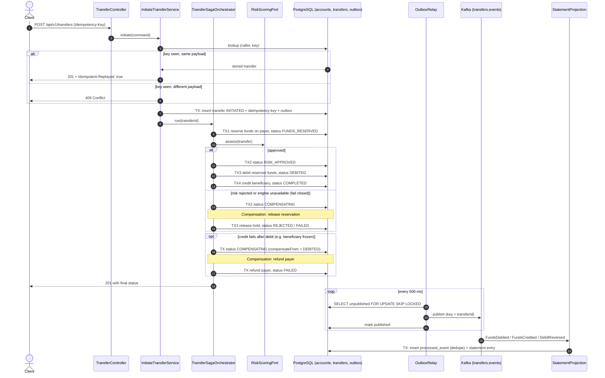
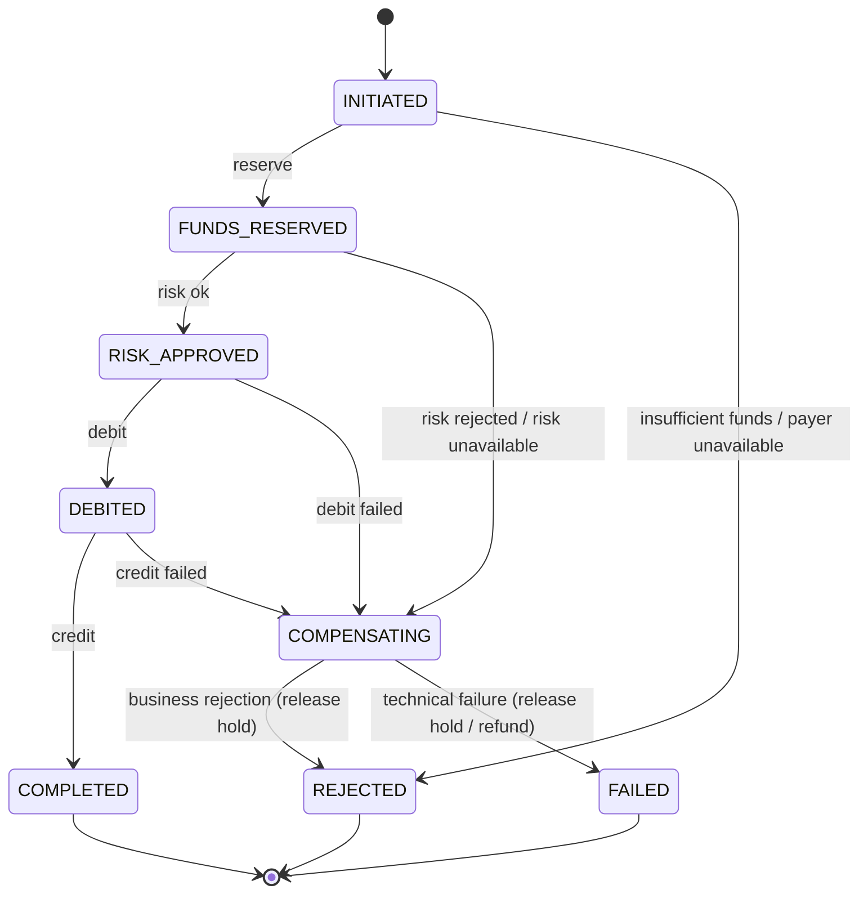
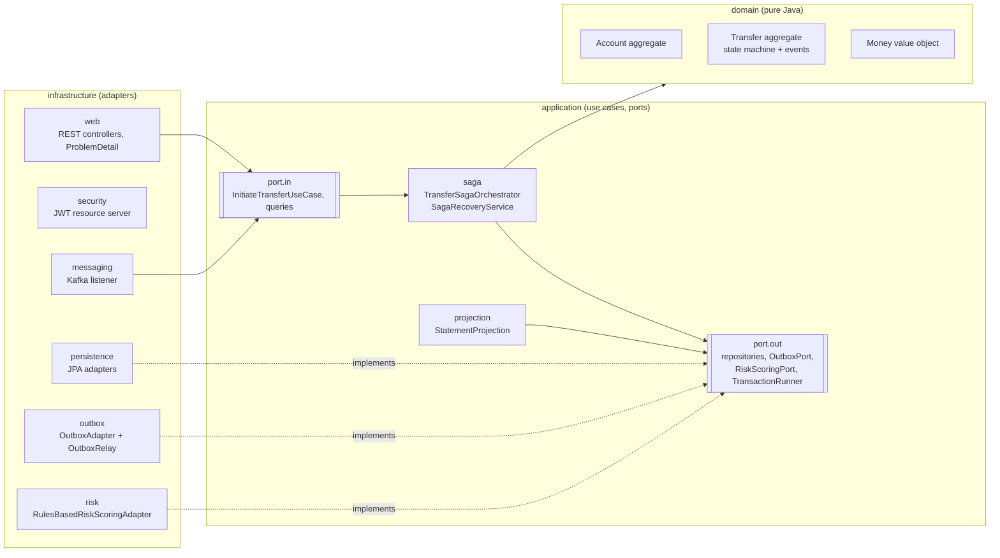

# fintech-transfers-saga

[](https://github.com/Juankia/fintech-transfers-saga/actions/workflows/ci.yml)


[](LICENSE)

A money-transfer service for a digital bank, built to show how to move money **correctly** across
several steps that can each fail. Retries, crashes, duplicate messages and fraud checks are all
handled explicitly.

It is a compact reference implementation of patterns I have used in production payment systems:

| Concern | How it is solved here |
|---|---|
| Multi-step business transaction | **Orchestrated Saga** with explicit compensations and crash recovery |
| "Saved to DB but event lost" | **Transactional Outbox** + relay to Kafka |
| At-least-once delivery | **Idempotent consumer** (processed-events table) |
| Client retries / double clicks | **`Idempotency-Key`** header with payload fingerprinting |
| Fraud | Pluggable **`RiskScoringPort`**, rules-based adapter (amount, velocity, new beneficiary) |
| Read vs. write load | **CQRS-lite**: account statement served from a projection |
| Architecture drift | **Hexagonal architecture**, enforced by ArchUnit tests |
| AuthN / AuthZ | OAuth2 **JWT resource server**, scopes + resource ownership via `@PreAuthorize` |

---

## Saga flow

Each arrow into the database is **one local ACID transaction**. It updates the aggregates, moves the
transfer to its next status, and appends the domain events to the outbox, all in that one transaction.



### State machine



The persisted status always names the next step. That is why `SagaRecoveryService` can resume a
saga that was interrupted by a crash or deploy. It runs on a schedule and picks up transfers that
have not moved for 30 s.

---

## Architecture



* **Domain and application have zero framework dependencies.** No Spring, JPA, Jackson or Kafka.
  `ArchitectureTest` enforces this on every build. The application layer controls transaction
  boundaries through its own `TransactionRunner` port.
* **Aggregates**: `Account` (balance + reservations, optimistic locking) and `Transfer` (saga state
  machine that raises domain events). `Money` is an immutable value object: `BigDecimal` + `Currency`,
  scale normalised to minor units. Extra precision is **rejected, never rounded**.
* JPA entities live only in the persistence adapter, and the adapters map them to and from the aggregates.

```
src/main/java/io/github/juankia/transfers
├── domain          model/ (Account, Transfer, Money, ...)  event/  exception/
├── application     port/in  port/out  saga/  service/  projection/  exception/
└── infrastructure  web/  security/  persistence/  outbox/  messaging/  risk/  config/
```

---

## Quickstart

Prerequisites: JDK 17, Maven 3.9, Docker.

```bash
# 1. Infrastructure: PostgreSQL 16 + Kafka (KRaft)
docker compose up -d

# 2. Run the service with demo data and the local token issuer
mvn spring-boot:run -Dspring-boot.run.profiles=dev

# 3. Tests: unit + integration (H2 + embedded Kafka, no Docker needed)
mvn verify
```

Swagger UI: <http://localhost:8080/swagger-ui.html>

### Demo accounts (`dev` profile only)

| Owner | Account id | Balance | Status |
|---|---|---|---|
| alice | `11111111-1111-1111-1111-111111111111` | 5,000.00 USD | ACTIVE |
| bob | `22222222-2222-2222-2222-222222222222` | 1,000.00 USD | ACTIVE |
| carol | `33333333-3333-3333-3333-333333333333` | 0.00 USD | FROZEN |

### Getting a token

In production the service validates JWTs from your identity provider. Set `JWT_ISSUER_URI` to a
Keycloak, Okta, Cognito or similar issuer. For local work, the `dev` profile swaps in an in-process
HS256 issuer. **Its key is generated at random on every startup, so no secret is ever committed.**

```bash
TOKEN=$(curl -s -X POST "localhost:8080/dev/tokens?subject=alice" | jq -r .access_token)
```

Scopes: `transfers:write`, `transfers:read`, `accounts:read`. By default the token gets all three.
Pass `&scope=accounts:read` to request fewer.

### curl examples

```bash
ALICE=11111111-1111-1111-1111-111111111111
BOB=22222222-2222-2222-2222-222222222222
CAROL=33333333-3333-3333-3333-333333333333
KEY=$(uuidgen)

# Happy path -> COMPLETED
curl -i -X POST localhost:8080/api/v1/transfers \
  -H "Authorization: Bearer $TOKEN" -H "Idempotency-Key: $KEY" -H "Content-Type: application/json" \
  -d "{\"sourceAccountId\":\"$ALICE\",\"targetAccountId\":\"$BOB\",\"amount\":125.00,\"currency\":\"USD\",\"reference\":\"dinner\"}"

# Retry with the same key -> same transfer, header Idempotent-Replayed: true, money moved once
# (re-run the exact command above)

# Same key, different amount -> 409 Conflict (problem+json)
curl -i -X POST localhost:8080/api/v1/transfers \
  -H "Authorization: Bearer $TOKEN" -H "Idempotency-Key: $KEY" -H "Content-Type: application/json" \
  -d "{\"sourceAccountId\":\"$ALICE\",\"targetAccountId\":\"$BOB\",\"amount\":999.00,\"currency\":\"USD\",\"reference\":\"dinner\"}"

# Beneficiary frozen -> debit is compensated by a refund -> FAILED / CREDIT_FAILED
curl -s -X POST localhost:8080/api/v1/transfers \
  -H "Authorization: Bearer $TOKEN" -H "Idempotency-Key: $(uuidgen)" -H "Content-Type: application/json" \
  -d "{\"sourceAccountId\":\"$ALICE\",\"targetAccountId\":\"$CAROL\",\"amount\":50,\"currency\":\"USD\"}" | jq

# Balance (write model, strongly consistent)
curl -s localhost:8080/api/v1/accounts/$ALICE -H "Authorization: Bearer $TOKEN" | jq

# Statement (read model fed by Kafka, eventually consistent)
curl -s localhost:8080/api/v1/accounts/$ALICE/statement -H "Authorization: Bearer $TOKEN" | jq
```

Sample response:

```json
{
  "id": "0b6f3f7e-5a0e-4a53-9d0f-0f3c1b2d9c11",
  "sourceAccountId": "11111111-1111-1111-1111-111111111111",
  "targetAccountId": "33333333-3333-3333-3333-333333333333",
  "amount": 50.00,
  "currency": "USD",
  "status": "FAILED",
  "failureReason": "CREDIT_FAILED",
  "failureDetail": "Account 33333333-3333-3333-3333-333333333333 is FROZEN and cannot be operated",
  "riskScore": 15
}
```

### Risk rules (`transfers.risk.*`)

| Signal | Condition | Points |
|---|---|---|
| `HIGH_AMOUNT` | amount > 10,000 | 60 |
| `ELEVATED_AMOUNT` | amount > 2,000 | 25 |
| `HIGH_VELOCITY` | ≥ 5 transfers from the same account in 10 min | 40 |
| `NEW_BENEFICIARY` | no previous completed transfer to this beneficiary | 15 |

A transfer is rejected when its score is **≥ 70**. All thresholds are configuration properties. To
replace the rules engine with an ML model or a vendor API, implement `RiskScoringPort`. The saga
does not change.

---

## Design decisions

### Why orchestration and not choreography?

A transfer has a strict order of steps (hold, check risk, debit, credit), and each failure point
needs its own compensation. With **choreography**, that flow would be spread across event handlers
in several services. Nobody owns the end-to-end state, and answering "where is transfer X stuck?"
means correlating logs. With **orchestration**:

* the whole workflow is readable in one class (`TransferSagaOrchestrator`);
* the saga state is a single persisted column, so it is queryable, auditable and resumable;
* compensations are explicit and tested one by one;
* adding a step (e.g. AML screening, 3-D Secure) changes one place.

The trade-off is that the orchestrator becomes a central component. That is acceptable here
because it is stateless: all of its state is in the database. It is also safe to run on several
instances, because optimistic locking (`@Version` on both aggregates) means a step can only commit
once.

### Why a transactional outbox?

Writing to the database and then publishing to Kafka is a dual write. If the process dies between
the two, the ledger and downstream consumers disagree for good. Here, every state change and its
events are committed **atomically** to `outbox_events`. `OutboxRelay` then publishes them:

* at-least-once, keyed by `transferId` so that all events of a transfer stay ordered on one partition;
* a failed send stops the batch to preserve order, and the next poll retries;
* `SELECT ... FOR UPDATE SKIP LOCKED` lets several relay instances share the work on PostgreSQL;
* the producer uses `acks=all` + `enable.idempotence=true`.

The cost is some extra publish latency (the poll interval). A CDC tool such as Debezium can tail
the outbox table instead of polling without touching the domain code.

### Why consumer idempotency?

At-least-once delivery means duplicates *will* happen: relay retries, consumer rebalances, replays.
`StatementProjection` records each `eventId` in `processed_events` **in the same transaction** as
the read-model write, so a redelivered event is skipped rather than counted twice.

### How the Idempotency-Key works

* Keys are scoped **per caller** (`owner_id` + key), so two clients cannot collide.
* The service stores a SHA-256 **fingerprint** of the business payload. Because `Money` normalises
  scale, `150` and `150.00` produce the same fingerprint.
  * same key + same payload → the original transfer comes back (`Idempotent-Replayed: true`) and no money moves;
  * same key + different payload → `409 Conflict`.
* **Races**: the transfer and its key are inserted in one transaction, guarded by a primary-key
  constraint. A concurrent duplicate loses on that constraint and replays the winner's result.
  `TransferIdempotencyIT` tests this with parallel requests.

### Other choices

* **Reserve then debit** (authorisation hold). The risk check runs while the funds are held, so a
  concurrent transfer cannot spend the same money. A rejection only drops the hold, and the ledger
  balance is never touched.
* **Compensations never fail on business rules.** `releaseReservation` and `refund` skip the
  "account active" check: once money has left, it must be possible to return it even if the
  account was frozen in the meantime.
* **Risk is fail-closed.** If the engine is unavailable, the transfer is compensated, never approved
  by default.
* **The risk call runs outside any DB transaction**, so a slow engine does not hold row locks.
* **Every error is an RFC 9457 `ProblemDetail`.** Business outcomes such as REJECTED and FAILED are
  returned as resource state, not as HTTP errors.
* **Other users' transfers return 404**, which stops callers from probing transfer ids.
* **CQRS-lite**: `GET /accounts/{id}` reads the write model and is strongly consistent.
  `GET /accounts/{id}/statement` reads a denormalised projection that is eventually consistent and
  can scale or be rebuilt independently.

---

## Testing

```
mvn verify      # 37 unit tests (surefire) + 18 integration tests (failsafe)
```

| Layer | What | Tools |
|---|---|---|
| Domain | `Money`, `Account`, `Transfer` invariants and transitions | JUnit 5, AssertJ |
| Saga | happy path, every compensation branch, crash recovery, re-run is a no-op | JUnit 5, Mockito, in-memory fakes |
| Application | idempotency replay / conflict / race, ownership | Mockito |
| Risk | each rule and the reject threshold | Mockito |
| Architecture | layer rules, framework-free core | ArchUnit |
| Integration | idempotency over HTTP (incl. concurrency), compensations, outbox → Kafka → read model, consumer dedupe, JWT + scopes + ownership | `@SpringBootTest`, MockMvc, H2 (PostgreSQL mode), `@EmbeddedKafka`, Awaitility |

Integration tests use real signed JWTs and the real Flyway migrations. They need no Docker.

---

## Roadmap

- [ ] Run the saga asynchronously (command topic + `202 Accepted`) for high-latency steps
- [ ] Dead-letter topic and retry policy for the projection consumer
- [ ] Debezium CDC as an alternative to the polling relay
- [ ] Double-entry ledger (journal + postings) instead of balance columns
- [ ] Multi-currency transfers with an FX quote step
- [ ] Idempotency-key TTL / cleanup job
- [ ] Testcontainers profile (PostgreSQL + Kafka) for production-parity CI
- [ ] OpenTelemetry tracing across HTTP → outbox → Kafka → projection
- [ ] ML-based `RiskScoringPort` adapter alongside the rules engine

---

## About the author

**Juan Carlos Amay**: Senior Backend Engineer with 8+ years building fintech and digital-banking
platforms (Java / Spring Boot, Kafka, event-driven architectures, CQRS, Sagas, DDD), and lately
applied AI.

* GitHub: [github.com/Juankia](https://github.com/Juankia)
* LinkedIn: [linkedin.com/in/juancarlosamayizquierdo](https://linkedin.com/in/juancarlosamayizquierdo)

Licensed under the [MIT License](LICENSE).
